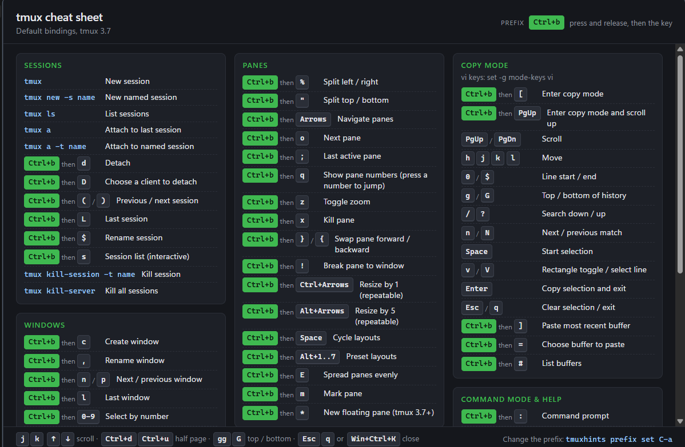

# tmuxhints

[](https://github.com/cicorias/tmuxhints/actions/workflows/ci.yml)
[](https://github.com/cicorias/tmuxhints/releases)
[](LICENSE)

**A tmux cheat sheet one keystroke away.** tmuxhints sits in your system tray and pops up
every tmux binding when you press **Win+Ctrl+K**, showing **your** prefix key instead of
"Prefix". Press the hotkey again, or `Esc`, and it's gone.



## Features

- **Global hotkey**: Win+Ctrl+K on Windows, Ctrl+Cmd+K on macOS, Super+Ctrl+K on Linux. You can change it.
- **Your prefix, everywhere**: set `C-a` (or anything else) once, and every binding shows it.
- **Keyboard-friendly**: scroll with arrows or vim keys, and close with `Esc` or `q`.
- **Conflict checks**: before using a new hotkey, it checks Windows/macOS reserved
  shortcuts, other apps holding the combo, and existing Hyprland binds.
- **Starts at logon** without admin rights.
- **Your own bindings**: extend or replace the sheet with a small JSON file.
- **Small**: uses the OS's built-in web view, so installers are 1–2 MB. The Linux
  AppImage is the exception, since it bundles its own.
- **Cross-platform**: Windows (x64, ARM64), macOS (Apple Silicon), Linux (x64).

## Install

Download the file for your platform from
[**Releases**](https://github.com/cicorias/tmuxhints/releases):

| Platform | File |
|---|---|
| Windows x64 | `tmuxhints_<version>_x64-setup.exe` (per-user installer), or `…_x64-portable.exe` (no install) |
| Windows ARM64 | `tmuxhints_<version>_arm64-setup.exe`, or `…_arm64-portable.exe` |
| macOS (Apple Silicon) | `tmuxhints_<version>_aarch64.dmg` |
| Linux x64 | `tmuxhints_<version>_amd64.AppImage` (any distro, including Arch/Omarchy), `.deb`, or `.rpm` |

Each release includes a `SHA256SUMS` file.

> [!NOTE]
> Builds are not code-signed yet.
> **Windows:** if SmartScreen warns, choose *More info → Run anyway*.
> **macOS:** right-click the app and choose *Open* the first time, or run
> `xattr -dr com.apple.quarantine /Applications/tmuxhints.app`.

## Using it

Run tmuxhints once and it lives in the tray; tick **Start at logon** in the tray menu to
keep it there. Press the hotkey (or left-click the tray icon) to show the sheet.

| Keys in the cheat sheet | |
|---|---|
| `j` `k` / `↓` `↑` | Scroll a line |
| `Ctrl+d` / `Ctrl+u` | Half a page down / up |
| `Space` `Shift+Space`, `PgDn` `PgUp`, `Ctrl+f` `Ctrl+b` | A page down / up |
| `gg` `Home` / `G` `End` | Top / bottom |
| `Esc`, `q`, the hotkey, or clicking elsewhere | Close |

### Command line

```sh
tmuxhints                                     # start in the tray (launching again shows the sheet)
tmuxhints --toggle | --show | --hide | --quit # control the running app

tmuxhints prefix get
tmuxhints prefix set C-a                      # tmux notation or Ctrl+a

tmuxhints hotkey get
tmuxhints hotkey check "Win+Alt+H"            # report conflicts; exit 1 if any
tmuxhints hotkey set "Win+Alt+H" [--force]    # checks for conflicts before saving

tmuxhints autostart status | enable | disable
tmuxhints hyprland status | install | remove [--force] [--dry-run]
tmuxhints config path                         # where settings and cheatsheet.json live
```

A running app picks up `prefix set` and `hotkey set` changes immediately.

### Add your own bindings

Create `cheatsheet.json` in the config folder (`tmuxhints config path`). Sections with an
existing name are extended, and new ones are added at the end. Use `Prefix` in `keys`
where your prefix should appear:

```json
{
  "sections": [
    {
      "name": "My bindings",
      "items": [
        { "keys": "Prefix r", "desc": "Reload ~/.tmux.conf" },
        { "keys": "Prefix |", "desc": "Split left / right" }
      ]
    }
  ]
}
```

Add `"replace": true` at the top level to replace the built-in sheet entirely. If the
file has a mistake, the built-in sheet is still shown, with a warning at the top.

| Settings | Location |
|---|---|
| Windows | `%APPDATA%\tmuxhints\` |
| macOS | `~/Library/Application Support/tmuxhints/` |
| Linux | `~/.config/tmuxhints/` |

### Omarchy / Hyprland

Wayland doesn't let apps grab global keys, so on Hyprland the hotkey is a compositor
binding that runs `tmuxhints --toggle`:

```sh
tmuxhints hyprland install    # adds the bind to ~/.config/hypr/bindings.conf
tmuxhints autostart enable    # adds an exec-once to ~/.config/hypr/autostart.conf
tmuxhints hyprland status     # installed / out of date / conflicts
```

tmuxhints only edits its own marked block in each file, repairs it if it's out of date,
removes it on `remove` / `disable`, and keeps the previous file as `*.conf.bak`.

## Development

Tools and tasks are managed with [mise](https://mise.jdx.dev). The app is
[Tauri 2](https://tauri.app) (Rust) with a plain HTML/CSS/JS popup, and has no Node build step.

```sh
mise install      # Rust, tauri-cli, actionlint
mise run doctor   # check OS prerequisites (WebView2, MSVC, webkit2gtk, …)
mise run dev      # run the app
mise run check    # format check, clippy, tests, workflow lint (what CI runs)
mise run dist     # build installers for this machine into ./dist
mise tasks        # everything else
```

```
src-tauri/   Rust app: tray, hotkey, CLI, settings, Hyprland integration
ui/          the cheat-sheet popup (HTML/CSS/JS)
scripts/     project scripts in Rust (cargo xtask doctor | dist | msix)
packaging/   Microsoft Store manifest template and package identity
```

**Releasing:** bump `version` in `src-tauri/Cargo.toml` and push a `v*` tag. CI builds
every platform and creates a draft release with all installers and checksums. Review it,
then publish.

**Microsoft Store:** `mise run msix` builds the x64 + ARM64 `.msixbundle`; see
[docs/microsoft-store.md](docs/microsoft-store.md) for identity setup, local testing and
submission.

## License

[MIT](LICENSE)
