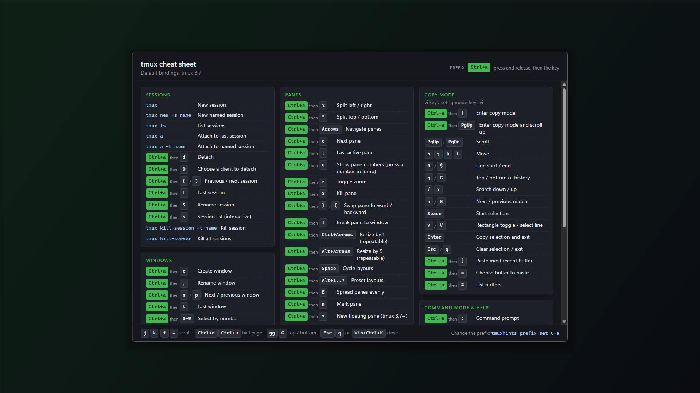

# Publishing to the Microsoft Store

tmuxhints ships to the Store as an **MSIX bundle** (x64 + ARM64). The package is built
unsigned; the Store signs it during certification, so no code-signing certificate is
needed.

## How the Store build differs

The same exe runs packaged and unpackaged; it detects the package at runtime.

| | Installer / portable build | Store build |
|---|---|---|
| Start at logon | `HKCU\…\Run` registry value | Manifest `StartupTask`, listed in **Settings › Apps › Startup** |
| `tmuxhints` on the command line | the exe on `PATH` | App execution alias (`tmuxhints.exe`) |
| Config folder | `%APPDATA%\tmuxhints` | `%LOCALAPPDATA%\Packages\<family>\LocalCache\Roaming\tmuxhints` for a fresh install; an existing `%APPDATA%\tmuxhints` is used in place |

`tmuxhints config path` and the tray's **Open config folder** always show the real
location.

## One-time setup in Partner Center

1. **Reserve the app name** (Apps and games › New product › MSIX or PWA app). Reserved:
   **tmuxhints**.
2. Open **Product management › Product identity** and copy the three values into
   [`packaging/msix/identity.env`](../packaging/msix/identity.env):

   ```ini
   IDENTITY_NAME=12345Publisher.tmuxhints        # Package/Identity/Name
   PUBLISHER=CN=XXXXXXXX-XXXX-XXXX-XXXX-XXXXXXXXXXXX   # Package/Identity/Publisher
   PUBLISHER_DISPLAY_NAME=Your Publisher Name    # Package/Properties/PublisherDisplayName
   DISPLAY_NAME=tmuxhints                        # must match the reserved name
   ```

   These values are public (every installed package shows them), so commit them.

## Build the package

```sh
mise run msix    # -> dist/tmuxhints_<version>.0.msixbundle
```

CI also builds it on every push: download the **store-msixbundle** artifact from the
workflow run. Every submission needs a higher version than the last one, so bump
`version` in `src-tauri/Cargo.toml` first (the package version is that plus `.0`).

### Test it locally first

With Windows **Developer Mode** on (Settings › System › For developers):

```sh
mise run msix:register     # install the unsigned x64 package from its folder
tmuxhints --show           # in a new terminal: the alias should resolve
mise run msix:unregister   # remove it (also deletes its private data)
```

Quit any other running tmuxhints first; a running copy receives the launch instead.

### Run the App Certification Kit

The Store runs the same checks during certification; running them first saves a round
trip. It needs admin rights, so it elevates with Windows `sudo` (one UAC prompt per
step):

```sh
mise run msix:wack    # rebuild the bundle, run appcert, summarize failures
```

Reports are kept in `target/wack/`. Leave the machine alone while it runs: the kit
installs, launches and removes the package.

## Submission

| Section | What to enter |
|---|---|
| **Packages** | Upload `tmuxhints_<version>.0.msixbundle`. |
| **Pricing and availability** | Free (or your choice). |
| **Properties** | Category: *Developer tools*. Privacy policy URL: link to [`PRIVACY.md`](../PRIVACY.md) on GitHub. |
| **Age ratings** | Complete the questionnaire (no user content, no data collection). |
| **Store listing** | See below. |
| **Submission options › restricted capabilities** | Paste the [`runFullTrust` justification](#runfulltrust-justification) below. |

### Store listing

**Description**

> tmuxhints puts a tmux cheat sheet one keystroke away. It sits in your system tray, and
> pressing Win+Ctrl+K pops up every tmux binding (sessions, windows, panes, copy mode,
> commands), showing *your* prefix key instead of "Prefix". Press the hotkey again, or
> Esc, and it's gone.
>
> Scroll with the arrow keys or vim keys, change the hotkey with built-in conflict
> checks, add your own bindings in a small JSON file, and start it at sign-in. Includes a
> `tmuxhints` command for scripting.

**Features** (one per line)

- Global hotkey (default Win+Ctrl+K) shows the cheat sheet over any app
- Shows your own tmux prefix, e.g. Ctrl+a
- Keyboard scrolling with arrows or vim keys
- Remappable hotkey with conflict checks
- Add your own bindings with a JSON file
- Starts at sign-in (optional)
- Command-line interface: `tmuxhints prefix set C-a`

**Search terms**: tmux, terminal, cheat sheet, keyboard shortcuts, hotkey, developer tools, vim

**Screenshots** (desktop minimum 1366 × 768): upload the 1920 × 1080 captures in
[`docs/store/`](store/). They're real captures of the popup on a plain background.
Regenerate them after UI changes with `mise run store:screenshots` (quit tmuxhints
first; it uses a throwaway config folder, so your settings aren't touched).

| | |
|---|---|
|  |  |
| Default `Ctrl+b` prefix | Custom `Ctrl+a` prefix |

## runFullTrust justification

Partner Center asks for this on the submission's **Submission options** page once the
uploaded package declares the capability. Paste:

```text
tmuxhints is a desktop (Win32) tray app that shows a tmux keyboard-shortcut cheat sheet. It needs runFullTrust to:
- register a system-wide hotkey (RegisterHotKey, default Win+Ctrl+K) that shows and hides the cheat-sheet window from any app;
- show a notification-area (tray) icon and menu;
- provide a command-line interface through its app execution alias (e.g. "tmuxhints prefix set C-a").
It makes no network connections, collects no data, does not run elevated, and only reads and writes its own settings in the user's AppData folder.
```

## About `runFullTrust`

Every desktop (Win32) app in the Store declares the `runFullTrust` restricted capability:
it means "this is a normal desktop app", not a sandboxed UWP app, and it's what lets
tmuxhints register a global hotkey and show a tray icon. Partner Center asks you to
justify any restricted capability, and submissions that use one get a manual review,
which can add a day or two to certification. It isn't a red flag: it's the standard
situation for any packaged desktop app, and the justification above is enough.

## Certification kit results

The last local run of the App Certification Kit (`mise run msix:wack`, 0.1.0.0) passed
overall. One **optional** test reported issues, which don't block certification:

- *Blocked executables*: the exe references `CreateProcessW` / `ShellExecuteW` and
  contains the strings `cmd`, `cmd.exe` and `basH`. The process APIs are used to open
  Explorer (**Open config folder**, Settings › Startup) and to signal a running copy of
  itself (`--reload`). Rust's standard library contains `cmd.exe` for running batch
  files, and `basH` looks like an incidental byte sequence in the binary. tmuxhints
  never starts a shell.
